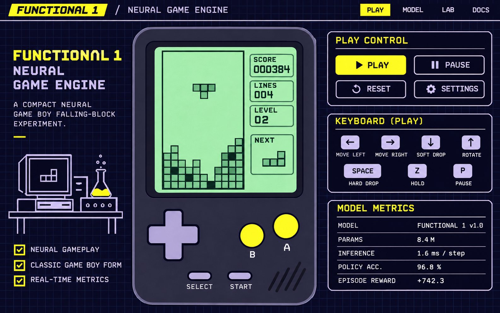

# Functional 1

The [Functional 2 release](docs/functional-2-baseline.md#functional-2-release) adds a native 160×144 display, the title and pause menus, and automatic gravity. The hosted application opens [V2](https://tetris.progsoft.eu/) by default. Select [V1](https://tetris.progsoft.eu/v1) to compare with the original release. Each version keeps its own game state.

Neuronal Tetris Color opens with a bunny pilot dodging asteroids and parachuting down to the animated title screen. It adds a Game Boy Color-style palette, seven candy-colored sprites, and new pause, game-over, and Progsoft credits screens. It uses the V2 recurrent gameplay model with a separate color readout fitted on the recolored captures. [Play V3](https://tetris.progsoft.eu/v3)

Functional 1 is a small action-conditioned game model. You choose the buttons and the model produces the next screen from the current image and recurrent memory. The released checkpoint is the 329,982-byte V85 model from the verified human playthrough.

## Play locally

```sh
python -m pip install -r requirements.txt
python play.py
```

Open [the local game](http://127.0.0.1:8765/). Use the arrow keys to move and soft drop, Z and X to rotate, and Enter for the in-game pause. The application also has a separate pause button that stops requests. The release directory contains the verified checkpoint, the first playable reference screen, and their SHA-256 digests.

On the V2 title screen, use Left or Down to lower the starting level and Right or Up to raise it. Press Z or Enter to play at the selected level.

For V3, run the container below and open the local color game. Skip the opening animation with Enter, Z, or the Skip intro button. V3 also honors your system's reduced-motion setting. Choose starting level 1–10 with the arrow keys or the level buttons on the title screen. In play, tap Down for a quick drop or hold it to keep dropping. The game keeps the selected level when you restart. [Local V3](http://127.0.0.1:8765/v3)



[Mobile design concept](docs/design/functional-1-mobile.png)

## Container deployment

Build the root Dockerfile and route traffic to port 8765. The health endpoint is `/health`. The build verifies all three release manifests, exports the ONNX models, and serves static assets. Open `/` for V2, `/v1` for V1, or `/v3` for Neuronal Tetris Color. Once a version is loaded, the browser keeps its game state and runs inference locally.

```sh
docker build -t functional-1 .
docker run --rm -p 8765:8765 functional-1
```

Run `python checks/browser.py` against the running container to verify the three releases. The V3 check covers the intro, level selection and the level 10 HUD, quick rotations and drops, credits, pause and resume, game over, and restart. It plays a full game with the network disconnected after loading the model.

## Training

Use the [game model cookbook](docs/game-model-cookbook.md) to adapt this workflow to another game.

1. Capture Adjustris v1.1 with PyBoy. Record four Game Boy frames per command and reduce the 160×144 screen to 80×72 with four shades. Each trajectory stores screens and the corresponding button sequence. Divide the recordings by episode before extracting windows.
2. Train the image dynamics from the observed screen, current button and causal history. The early baseline used a convolutional GRU with categorical pixel loss. The released scene model uses a learned tile representation, recurrent visual features and separate predictions for the moving piece, stack, preview and screen transitions.
3. Supplement recorded play with controlled branches from verified screen prefixes. Use these examples to study ambiguous movement, rotation, contact and line clearing. Fit corrections on training examples and check them on separate validation branches.
4. Replay native screenshots to recover small HUD digits that the reduced raster aliases. Learn when a rendered deposit or completed line clear updates the counter, then carry the digits through a learned decimal readout.
5. Preserve the V84 gameplay tensors and fit 24 pause transition coefficients on nine training sequences for V85. Keep the previous screen and recurrent state while paused. Compare the pause panel and the first resumed frame to the reference on five separate validation games.

The ROM supplies training observations. In the hosted game, the browser feeds each generated screen and its recurrent state into the next model step.

### V3 color training

Supply the preserved Adjustris training corpus and both V2 reference corpora. Each directory must contain its original manifest and episode files.

```sh
python train_color.py --corpus "$ORIGINAL_CORPUS" \
  --corpus "$V2_REFERENCE_CORPUS" --corpus "$V2_SUSTAINED_CORPUS" \
  --output output/v3-color-training
```

The converter keeps the original action sequence and split for every episode. It pairs the 80×72 source screens with 160×144 indexed-color targets using the artwork in [color_art.py](color_art.py). The color readout fits a categorical tile output for the board and HUD from the training split. Validation and test compare those outputs with the recolored targets without updating the readout. The run writes the reformatted dataset, its manifest, and the fitted `color.json`.

The container uses the verified readout in `releases/functional-3/`. In the browser, the original recurrent output feeds the next model step and the color readout produces the displayed screen. The two versions share the V2 ONNX graphs, so V3 downloads only the additional color data.

The released fit used 82 training episodes and preserved 9 validation and 9 test episodes. The readout matched every evaluated board and HUD tile in both held-out splits. Those figures measure color rendering against the converted targets.

## What worked

- Predicting changes in a compact tile space helped retain the stack over long rollouts. A local proposal learned from actual button interventions corrected rotations and horizontal placement that the whole-board predictor missed.
- Checking animation and counters separately made it possible to distinguish a late visible lock from a wrong score increment. The final comparison found agreement on 51 counter sequences by one step after confirmation.
- The strongest end-to-end result was a human-controlled game from the first piece to the terminal menu. It ran for 2,534 model steps, cleared five lines and reached 540 points. The replay verified the compacted board on all five clears.

Browser validation of the model measured 27.5 ms p95 inference over 256 steps on the development Mac. The full game also exposed one premature lock, and fixed ROM input replays can diverge early because the learned timing differs.

## Reference

Adjustris v1.1 is the CC0 reference game used for captures. [Upstream project and license](https://github.com/tbsp/Adjustris)
